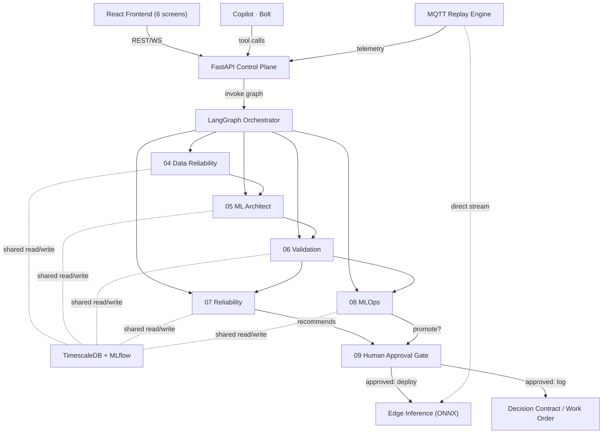

# Thor — Development Guide

> Agentic AutoML + MLOps copilot for industrial predictive maintenance.
> Governed architecture: **LLM plans → deterministic code computes → engineer decides.**
> This file is intentionally longer than the usual ~200-line CLAUDE.md guideline because it
> covers a multi-agent system end to end. If it gets stale, split sections into `.claude/rules/*.md`
> rather than letting this drift out of sync with the code.

Full function-level architecture reference (diagram + every function, role, and connection):
`docs/architecture.html` (open it in a browser).

## 1. What Thor is (read this before writing code)

Thor ingests raw industrial sensor telemetry, automatically profiles it, trains and validates
a predictive-maintenance model, explains its prediction with cited evidence, turns that into a
cost-based maintenance recommendation, and stops — every consequential action requires an
explicit human approval, logged as an immutable Decision Contract.

**Thor is a companion to the plant's MES/CMMS, not a replacement for one.** It does not schedule
production, manage inventory, or dispatch labor. Its output — the Decision Contract — is a
handoff artifact designed to feed an existing MES/CMMS, not become one. Never describe Thor as
an MES in code comments, docs, or the submission.

## 2. Submission positioning — Theme 1 (Agentic Predictive Maintenance Studio)

We submit under **Theme 1 only**. The verbatim one-liner, differentiators, rubric mapping, and
tech-stack name-drops live in the `submission-positioning` skill (`.claude/skills/`) — load it
and use its language verbatim whenever drafting submission text; don't invent new claims.

- **Never:** claim a specific dollar savings as fact (say "under these configurable plant-cost
  assumptions..."); cite unverified competitor claims; call any part of this an MES.

## 3. Tech stack

| Area | Choice | Note |
|---|---|---|
| LLM | OpenAI (chat completions, function calling) or Anthropic Claude (Messages API, tool use) — selected by `LLM_PROVIDER` / whichever key is set | Read **only** in `apps/api/orchestrator.py` — two calls per run: route, then draft the explanation; plus the Bolt tool loop |
| ML | scikit-learn, XGBoost, LightGBM | No CNN/autoencoder — dropped by design, not by omission |
| AutoML search | Optuna | Tree models only |
| Explainability | SHAP | Feeds `explain()` in the Reliability Agent |
| RAG / retrieval | Chroma (embedded) + sentence-transformers | Local embedding model — **no external embedding API**. Index built once at startup from `data/manuals/*.pdf`, persisted to a Docker volume |
| Agent orchestration | LangGraph | One process, five agent node groups — not five services |
| API | FastAPI + Pydantic | Single control-plane service |
| Frontend | React + TypeScript | Six screens (§5): Fleet is the landing view, the 3-D Digital Twin (three.js via React Three Fiber 8 + drei 9, React 18 kept, procedural geometry only, no CDN assets) has its own route |
| Streaming | Mosquitto (MQTT) + a replay script | Time-accelerated historical replay, not random live data |
| Storage | PostgreSQL + TimescaleDB extension | Telemetry hypertable, assets, decision contracts, registry metadata |
| MLOps | MLflow | Experiment tracking + registry, artifacts on a mounted Docker volume — **not MinIO** |
| Drift detection | Hand-rolled PSI | ~30 lines, not the Evidently library — one fewer dependency |
| Edge | ONNX Runtime in a second lightweight FastAPI container | Subscribes to MQTT directly, independent of the control plane. Infers the operating state from rpm/load with the sidecar baseline and applies the sidecar calibration transform, so it emits the same calibrated probability as the centre |
| Packaging | Docker Compose | **Not Kubernetes** — one command (`docker compose up`) must always work |
| CI | GitHub Actions | Lint + unit tests on push |
| Tests | pytest (logic) + 1-2 Playwright smoke tests | Not a full e2e suite |

## 4. Architecture



**Thor vs. Bolt, in one breath.** *Thor* is the whole system above: seven Compose services (plus the optional one-shot `prep` fallback job) and
one governed pipeline — MQTT telemetry into a FastAPI control plane and TimescaleDB, a
LangGraph orchestrator (the only Claude caller, and only to route and to phrase) driving five
deterministic toolboxes (state-aware profiling, Optuna over RF/XGBoost/LightGBM ranked by the
Industrial Model Score and tracked in MLflow, asset-level validation with calibration and lead
time, SHAP + cost comparison, an MLOps lifecycle that promotes the champion to ONNX Runtime at
the edge), producing an immutable Decision Contract that stops at the Human Approval Gate.
*Bolt* is one component inside it: the copilot persona in the Copilot screen, a conversational
surface over the Reliability toolbox's RAG layer (Chroma index of the plant manuals, local
embeddings) that reaches data only through read-only tools on the same control plane and can
explain but never approve, promote, train, or invent a citation.

Full prose + IN/OUT for every function: see `docs/architecture.html`.

## 5. Repository layout

Run `ls` for the tree. Non-obvious: `agents/*` are tool modules imported by `apps/api`'s LangGraph
graph, not services; the six web screens are Fleet (`/`, the landing view: the isometric/pixel
fleet), Asset 360, AutoML Studio, ModelOps, Copilot (Bolt) and the 3-D Digital Twin (`/twin`,
listed under Bolt in the side menu). The twin's code lives in `apps/web/src/twin/` (palette,
X-Ray HUD, rewind, sandbox panel, `scene/` for three.js) and its API in `apps/api/routes/twin.py`
(+ `apps/api/live.py`, `apps/api/plant.py`, `apps/api/sandbox.py`). The ONE status rule (alarm
on-delay, latch, clear) is `apps/api/alarms.py`; the replay gate is `apps/api/replay_control.py`.
The plant layout (five packaging lines plus a compressor hall) and the measured reasoning behind
it live in `data/simulator/layout.py`. Person-visible wording says **"state"** (operating state),
never "regime"; identifiers, API fields, DB columns and feature names keep `regime`.

## 6. Agent build spec (condensed — full detail in the linked artifact)

| # | Agent | Key functions | Produces → consumed by |
|---|---|---|---|
| 04 | Data Reliability | `profile_dataset()`, `detect_missingness()`, `detect_regime()`, `validate_schema()` | Data Quality Contract → 05 |
| 05 | ML Architect | `make_asset_split()` (seeded train/validation/calibration/test, fixed first), `infer_task()`, `build_feature_pipeline()` (baseline fitted on train assets only; right-censors the last horizon), `launch_trial()` (fit on train, Optuna on validation), `compare_models()` | Candidate models + Industrial Model Score (MLflow), with the `AssetSplit` → 06 |
| 06 | Validation | `detect_leakage()`, `calibrate_probabilities()` (calibration assets; exports the transform), `compute_lead_time()`, `estimate_rul_interval()`, `validate()` (champion on validation assets, final metrics on untouched test assets, gate checklist) | Validation Report (split, gate, test metrics, thresholds, parity) + Champion → 07, 08 |
| 07 | Reliability | `explain()`, `retrieve_manual_context()`, `calculate_failure_cost()`, `find_maintenance_window()`, `run_whatif()`, `create_decision_contract()` | Decision Contract + recommendation → 09 |
| 08 | MLOps | `check_edge_parity()` (ONNX + sidecar vs calibrated centre on held-out vectors; failing parity blocks promotion), `register_model()`, `compare_champion()`, `promote()` (refuses failed validation or parity), `detect_drift()`, `deploy_edge()` (tree → ONNX, calibration + baseline → sidecar) | Promotion request → 09; on drift, re-triggers 05 |
| 09 | Human Approval Gate | `present_evidence()`, `record_decision()` | Two separate decisions, never substitutable: a **maintenance** approval (contract) → logged Decision Contract handed to the plant as a work order, nothing else; a **promotion** approval (ModelOps, `decide_promotion_db()`) → `promote()` + edge deploy. A failed validation gets no promotion request and `promote()` refuses it |

`promote()` models the lifecycle (`candidate → validated → shadow → production`) as a **database
enum**, not live traffic-splitting — there is no real production traffic to shadow-test against
in a demo. Don't build real shadow/canary infrastructure.

The orchestrator itself (`apps/api/orchestrator.py`) is the only *agent* in the AI sense — the
five groups above are deterministic toolboxes it calls. Its own surface is small: `route()`
picks the next tool from `GraphState`, `await_approval()` pauses the graph at the Human
Approval Gate node, `resume()` continues once a decision is recorded.

## 7. Non-negotiable rules

- **NEVER** let an agent execute a maintenance action or model promotion without a recorded
  approval from `record_decision()`. This is the whole governance pitch — do not weaken it for
  a demo shortcut.
- **NEVER** validate with a random shuffle split on time-series or multi-asset data. Use
  time-ordered and asset-level splits (train on some machines, validate/test on ones the model
  has never seen).
- **NEVER** let the LLM compute a metric, a cost, or a SHAP value. It explains numbers that
  deterministic Python already produced — it does not produce them itself.
- **NEVER** read `ANTHROPIC_API_KEY` or `OPENAI_API_KEY` outside `apps/api/orchestrator.py`. One file calls the LLM;
  every other module is deterministic local compute. This is what makes the governance claim
  checkable rather than rhetorical.
- **NEVER** let the LLM invent a manual citation. `retrieve_manual_context()` returns retrieved
  passages with their source and section; the explanation may only quote what it returned.
- **ALWAYS** log Decision Contracts as immutable rows (insert-only; no in-place edits).
- **ALWAYS** default new agents/services to the `docker-compose.yml` — if it doesn't start with
  `docker compose up`, it isn't done.

## 8. Explicitly out of scope

Do not build these — they cost real hours for near-zero demo-visible payoff:

Kubernetes · real OPC UA / PLC protocol · CNN / autoencoder models · MinIO · Redis (unless a
concrete need appears) · full Prometheus/Grafana/OpenTelemetry stack (build a health panel in
the React app instead) · Neo4j · blockchain · native mobile app · real SAP/ABB API integration ·
a full Playwright e2e suite.

## 9. Data strategy

1. **Primary demo data — synthetic.** A state-based generator (24 motors, three operating
   states on a shift schedule, injected drive-end bearing degradations — see `FAULTY_ASSETS` in
   `data/simulator/generate.py`) gives full control over the "cinematic" demo moment and stays
   100% reproducible via MQTT replay. **Fault timing (re-timed 2026-10-12, team-approved):** six
   completed failures (MTR-003/009/013/017/021/023) all lie inside the seeded 80 % of the history
   and are what the model learns from; `MTR-042` is healthy for the whole seeded part, starts
   degrading 4 plant hours after the seed point (`DEMO_ONSET`), ramps to full severity over
   `FAULT_RAMP_H` (16 plant hours, the same per-sensor signature as every other fault) and then
   runs on the damaged bearing until the end of the timeline — nothing in the data repairs it;
   only the engineer's work order does. Only MTR-042 goes wrong live.
   The API seeds the first 80% of the history. **Nothing streams at start-up:** the replay
   container polls `GET /replay` and starts only once a production model exists, i.e. after a
   named approver signs off a promotion in ModelOps (pause/resume exist as a recovery tool, no
   other controls). It then streams the rest and keeps replaying the same story with timestamps
   shifted by one full timeline per pass, so plant time never stops moving and a repair after
   approval is always visible (rows with an existing `(asset_id, ts)` are ignored on insert).
   Only *completed* failures produce training labels — an in-progress degradation is treated as
   unknown future, never as a known outcome. **Status is one rule in the API**
   (`apps/api/alarms.py`): three consecutive predictions ≥ 0.3 raise a warning, three ≥ 0.5
   raise a critical that stays latched until a completed work order clears it, a warning clears
   after six consecutive predictions below 0.3. Fleet, twin, HUD, rewind markers and Bolt all read
   it; the raw per-sample probabilities stay visible.
   **Sandbox (3-D twin):** sliders, "Troubleshoot <motor>", "Random fault", "Shake up operations"
   and "Reset sandbox" are insert-only `sandbox_events`; the replay applies them to its own
   stream (`streaming/replay/sandbox.py`), so sandbox readings take the real path replay → MQTT →
   edge → control plane and are scored like plant data. Every such reading, prediction, alarm,
   contract and work order carries a `sandbox` tag; training, validation, drift and the rewind's
   lead time exclude tagged rows; "Reset sandbox" clears alarms sandbox readings alone raised.
   **After an approval, the plant acts, not Thor.** The replay doubles as a simulated CMMS
   (`streaming/replay/work_orders.py`): once plant time reaches the approved window it takes the
   motor offline for the contract's planned downtime (no rows) and then streams that motor's own
   healthy baseline again. The API only records the plant's progress reports as insert-only
   work-order events (`GET/POST /work-orders`) and shows them on the Fleet card and in Asset 360.
   For the demo the simulated CMMS executes at the approval, not at the window
   (`REPLAY_WORK_ORDER_EXECUTE=approval`, the default; `window` is the faithful mode), so the
   motor visibly goes offline and comes back healthy within seconds of the click; the event note
   records the scheduled window the plant would really have used.
   Rejected contracts and `run_to_failure` change nothing. Maintenance windows are computed in
   plant time (latest telemetry `ts`), never wall clock, so the window lands inside the replay.
2. **Credibility check — AI4I 2020 (UCI).** Run the same pipeline against a real public
   benchmark and report honest metrics. This is what proves the methodology isn't cherry-picked
   to the synthetic story.

## 10. Development commands

Create these exactly as the project is scaffolded — don't invent different entrypoints:

```bash
docker compose up --build        # everything: api, web, timescale, mqtt, mlflow, edge, replay (seeded; no model; replay held)
docker compose run --rm prep     # MANUAL FALLBACK (profile "prep"): train, validate, promote as demo-prep@thor, score
uvicorn apps.api.main:app --reload   # api only, for fast iteration
python -m scripts.demo_prep --api http://localhost:8000   # the same fallback, natively (train, validate, promote, export, score)
npm --prefix apps/web run dev    # frontend only
pytest                            # all Python tests
ruff check .                      # lint
npm --prefix apps/web run build && npm --prefix apps/web run test  # frontend build + smoke tests
scripts/demo_reset.sh   # (or .\scripts\demo_reset.ps1) wipe DB/model volumes, reseed 80%, hold the replay; --prep / -Prep runs the fallback
python -m data.benchmark.ai4i_benchmark --n-trials 6 --seed 0   # AI4I credibility benchmark
python -m data.simulator.layout                                 # print the measured duty table behind the plant layout
python evals/bolt/run_bolt_eval.py --min-pass 0.95              # Bolt copilot eval (template mode)
```

Two run modes on `POST /pipeline/run`: `mode=analyze` (default; what "Run analysis" sends) reuses the
production model and takes seconds; `mode=train` is the explicit AutoML run (AutoML Studio
"Train new model") and ends at stage `trained` with a pending promotion request for ModelOps.

## 11. Code style

- **Python:** type hints everywhere, Pydantic models for every agent input/output (this is what
  makes the LangGraph state typed and debuggable), `ruff` for lint/format.
- **TypeScript:** function components, no class components; colocate a screen's API calls with
  its component.
- **Commits:** imperative mood, one logical change per commit (`add state detection`, not
  `updates`).
- **Every deterministic tool function gets a docstring stating its inputs/outputs** — the
  orchestrator's tool-calling reliability depends on these being accurate, not decorative.

## 12. Working in this repo with Claude Code

- No Claude Code plugins are installed on the team laptop. The ECC plugin mentioned in older notes
  is not present, so don't look for its agents or `ListSkills`/`ListPlugins` tools. The one
  project skill is `.claude/skills/submission-positioning`.
- Use a research/explore-style subagent for open-ended searches across this repo once it's
  larger than a handful of files; use a general-purpose subagent for multi-file changes that
  span more than one of the directories in §5.
- Track multi-step build work (e.g., "implement Validation Agent") with the task-tracking tool
  as you go — mark steps complete as they land, don't batch it at the end.
- When a change touches §6 (agent contracts) or §7 (rules), update this file in the same PR.
  A stale CLAUDE.md is worse than none.

## 13. Timeline & definition of done

Idea Phase submission — lock down positioning (§2), architecture (§4), and this file. Prototype
Phase: Sept 18–27. Priority order under a tight time budget — do not start P1 before every P0
item runs end to end:

- **P0 (must work flawlessly):** ingest/replay → profile → train 3 candidates → validate →
  champion → SHAP explain → cost-based recommendation → human approval → Decision Contract
  logged. One motor, one fault, one decision, live in the demo.
- **P1:** cited manual context (Chroma RAG) on the explanation, MLflow registry + promote()
  state machine, drift detection, edge ONNX container, Fleet + ModelOps screens, Copilot chat.
  The P0 chain must produce a complete recommendation from SHAP + cost alone — retrieval
  enriches that explanation, it is never load-bearing for it.
- **P2 (cut first if time runs short):** what-if reliability sandbox, energy-residual feature,
  AI4I benchmark writeup polish.

## 14. References

- Full architecture cheat sheet (diagram + every function): `docs/architecture.html`
- Anthropic Claude Code best practices: https://code.claude.com/docs/en/best-practices
- AI4I 2020 Predictive Maintenance Dataset (UCI) — credibility benchmark, not primary demo data

## 15. Finals — in-person demo (Tuesday, Fort Smith, AR)

We are a top-4 finalist. Format: ~4 min slides, ~6 min live demo, then judge Q&A of similar length,
presented from the team's HP EliteBook 840 G8 (Intel Iris Xe integrated graphics) on venue Wi-Fi.
Competing teams also build with Claude, so polish and a coherent story beat feature count.

**Build order (stop and checkpoint between phases — each phase leaves the demo working):**
- **Phase 0 — Correctness pass** (`docs/finals/prompt-0-correctness.md`). An external review,
  verified against the code on 2026-10-11, found defects that contradicted our own claims:
  maintenance approval also promoted and deployed the model; failed validation didn't block
  promotion; simulator ground truth (`health`) leaked into fleet health; preprocessing was fitted
  before the asset split; edge probabilities skipped calibration and used a mismatched baseline;
  0.3 and 0.5 thresholds were mixed; and every "Run analysis" retrained the whole fleet. Phase 0
  fixes these. The leak-free metrics in `docs/finals/metrics.md` replace the prototype's numbers
  everywhere. Phase 0 also makes training inspectable, because judges will ask how the model was
  trained:
  - `docs/finals/model-card.md`;
  - an AutoML Studio view of the split, trials, champion score breakdown, gate checklist and parity
    result;
  - an AI4I benchmark rerun with the corrected method;
  - a Bolt evaluation case proving it refuses approvals.
- **Phase A — 3-D Digital Twin + X-Ray.** Built 2026-10-11 (see `docs/finals/status.md` Phase A
  and `docs/finals/session-notes.md`; file map in §16). The plant has two views of the same live data,
  with exactly these names in the UI:
  - **Fleet:** the existing isometric/pixel fleet view (the landing view again since Phase A.1;
    it was called "Dashboard" during Phase A).
  - **3-D Digital Twin:** a 3D, low-poly, "corporate clean" modern factory showing five packaging
    lines plus a compressor hall, driven by live API data; its own route, listed under Bolt.
  - An X-Ray toggle works in both views: hover shows a status glyph and key facts, click opens a
    futuristic HUD panel.
  - The app keeps its existing color scheme. Only the 3-D Digital Twin scene and its HUD try a
    neon-yellow and electric-blue scheme, kept in one place so it can be swapped back. The team
    evaluates it.
- **Phase A.1 — the hero demo, shown by hand** (`docs/finals/prompt-A1-hero-demo.md`, built
  2026-10-12). Only the plant data is simulated; everything the judges see really runs:
  1. open on Fleet, every motor grey ("no prediction yet"), no model exists; 2. AutoML Studio →
  **Train new model** (about a minute, talked over); 3. ModelOps → approve the promotion with a
  name — the fleet turns green ("within healthy baseline"), the edge loads the model and the
  recorded history starts streaming by itself; 4. MTR-042 goes amber then red on its own and
  stays red (latched); 5. Run analysis; 6. Bolt answers "What's happening with MTR-042?", "Give
  me the details.", "What are the possible fixes?"; 7. approve the Decision Contract on Asset 360;
  8. the motor goes offline and comes back green; 9. the 3-D Digital Twin (HUD, physical layout,
  rewind with "this run" vs "validated" lead time side by side); 10. the twin's sandbox. Click
  path, measured timings and recovery moves: `docs/finals/demo-walkthrough.md`.
- **Phase B — Bolt Designer.** This is Bolt's design mode, with its own nav item, Bolt's chat on
  the left and a spec workbench on the right. It answers a judge's question ("could it be used to
  create a motor?").
  - Deterministic code compares fleet spec and measured performance and proposes a spec envelope.
  - Bolt explains it in conversation and stays read-only.
  - The engineer clicks to draft a **Design Change Request**, then approves it via
    `record_decision()`. The request is insert-only and is a decision separate from maintenance
    and model promotion.
  - The AI never "decides": it finds the signal and makes the case, and a human signs. That's our
    answer to "can the AI make decisions?"
  - Stage line: "Bolt explains your fleet. Bolt Designer shows you how to build a better motor.
    You sign."
  - **The hero loop is detect → diagnose → redesign → install → plan.**
    1. MTR-042's Decision Contract opens Bolt Designer.
    2. The engineer approves a Design Change Request.
    3. The maintenance approval attaches it as the replacement spec. The contract stays immutable.
    4. The simulated work order installs the upgraded motor.
    5. The HUD shows the next inspection date, from a deterministic bearing rated-life (L10)
       estimate under measured duty. This is never a model prediction.
  - Post-repair telemetry is the normal healthy baseline. Never fabricate an upgrade payoff.
  - A deterministic **fault hypothesis** steers the redesign: possible bearing degradation, possible
    thermal overload, unclassified vibration anomaly, or insufficient evidence. Each comes with
    evidence, counter-evidence and limitations, and it is never called a confirmed root cause.
  - An insert-only **repair outcome** records what the plant found, shown next to the hypothesis.
- **Code freeze Monday 5 pm.** After that: only demo-blocking bug fixes; Monday evening and Tuesday
  morning are for rehearsing the hero story end to end.

**Finals-specific constraints:**
- Plant layout: the 24 existing motors are regrouped as Packaging Lines 1–5 (4 motors each) plus a
  Compressor Hall (4 motors). Only asset metadata (name, line) changes — never the telemetry
  generator's signals. `FAULTY_ASSETS` timing WAS re-timed on 2026-10-12 with the team's approval
  (§9: historical failures inside the seeded 80 %, MTR-042 healthy until after the seed point);
  the fault signature itself is unchanged and MTR-042 stays the hero fault, the Line 3 filler.
- Molding and Batching appear only as greyed-out site tabs (scalability story), not built.
- Cut for time: Streamline swim-lane/container drill-down, Plant Personas, real external plant data.
- 3D must hold ≥45 fps on Iris Xe at 1080p, work fully offline (no CDN assets, all geometry
  procedural or bundled), and fall back to the Fleet view if WebGL is unavailable.
- **The 3-D Digital Twin is data-first.**
  - It has no buildings, vehicles, people or decorative motion; everything that moves is driven
    by data.
  - It shows motors and their machines, the live message path motor → edge → control plane with
    measured rate and latency, state rings, decision badges, model provenance, and a rewind of
    stored predictions that shows this run's lead time next to the validated figure.
  - The test: an ABB engineer can point at any pixel and we can trace it to its source.
- Every number in the 3D view, the HUD and Bolt Designer comes from the API (deterministic Python).
- Plant-data integration panels show the kind of data a plant already captures:
  - PLC tags map one-to-one from real telemetry, each showing its source signal. Values with no
    telemetry source are marked "simulated".
  - MES context (SKU, container, quantity, UOM) is a deterministic "simulated MES feed". It is
    context only and never feeds a model, score or decision.
- Status encoding: healthy = green circle ("within healthy baseline"), warning = amber triangle,
  critical = red stop-octagon. Brand yellow is never used to mean "warning". Status comes from the
  API's latched alarm (`apps/api/alarms.py`), never from a browser-side threshold.
- Wording: a person reads or hears **"state"** ("State: heavy load", "the motor changed state",
  "state ring"), never "regime"; decision / data / alarm are labelled "Decision", "Data", "Status".
- The demo must run end to end in LLM template mode (venue Wi-Fi may drop).
- Simulator ground truth (`health`, `failure_within_h`) is for training labels and evaluation only.
  It never reaches live MQTT, fleet or asset responses, Bolt, Decision Contracts or the edge.
- The live demo trains on stage (AutoML Studio, about a minute, talked over) and signs the model
  off in ModelOps; the inference, the Decision Contract and the approval follow on the model just
  trained. `scripts/demo_prep.py` (`docker compose run --rm prep`) is the fallback if training
  fails on stage.
- Cut for time (from the external review): 120-motor scale, risk events and priority scoring,
  Decision Contract V2, maintenance outcomes, RAG metadata, Bolt tool expansion. They're roadmap
  material for the slides.

## 16. Working on the team laptop (verified 2026-10-11)

Facts that save exploration. Re-verify anything that looks wrong rather than trusting it blindly.

- **Shell:** Windows 11, Windows PowerShell 5.1. There's no `&&` or `||`; use `;` or
  `cmd; if ($?) { next }`. Tools installed mid-session may need the PATH refreshed:
  `$env:Path = [Environment]::GetEnvironmentVariable('Path','Machine') + ';' + [Environment]::GetEnvironmentVariable('Path','User')`.
- **Python:** the repo's `.venv` has every dependency, including dev extras, already installed.
  - Use `.\.venv\Scripts\python.exe -m pytest` and `.\.venv\Scripts\python.exe -m ruff check .`.
    The full suite has about 205 tests and takes about 70 s; collecting them takes about 12 s.
  - Set `MLFLOW_DISABLE_AGENT_HINT=1` to silence an MLflow banner.
- **Web:** `npm --prefix apps/web run build` / `run test`. Its `node_modules` is already installed.
- **Native end-to-end run** (preferred for checks):
  - API: `uvicorn apps.api.main:app` with `SEED_ON_START=1` on SQLite. Use port 8010 and point
    `DATABASE_URL`, `MODELS_DIR`, `CHROMA_PATH`, `MLFLOW_TRACKING_URI` at a scratch directory so a
    native run can never touch the Docker stack on 8000 or the repo's `thor.db`.
  - Keys: `.env` holds real provider keys, and PowerShell's `$env:X = ""` deletes a variable
    instead of blanking it, so the API will go to LLM mode. Set `$env:ANTHROPIC_API_KEY = " "`
    and `$env:OPENAI_API_KEY = " "` (a space) to force template mode for a native check.
  - Prep (fallback / metrics record): `python -m scripts.demo_prep --api http://127.0.0.1:8010
    --report docs/finals/prep-report.json`. The committed `docs/finals/prep-report.json` is the
    2026-10-12 run on the re-timed data (six completed failures).
  - Replay: `python -m streaming.replay.replay`. It uses MQTT if a broker is up, otherwise it POSTs
    to `/ingest`; it HOLDS until `GET /replay` reports a production model (`--no-gate` /
    `REPLAY_GATE=0` streams at once). A native broker for a second stack: run
    `C:\Program Files\mosquitto\mosquitto.exe -c <conf with "listener 1884">` directly (the
    Windows service stays stopped) and point `MQTT_BROKER_URL` at 1884.
  - Stop both when done.
  - The Docker stack must be down first, or port 8000 clashes.
- **Docker:** Docker Desktop runs on WSL2. Code is baked into the images (no source mounts), so
  every Docker test means a 5–10 min rebuild: test natively, and build once at the end. The team
  starts and stops the stack themselves. Compose project name is `thor-main` (run from the repo
  root), and host ports are bound to 127.0.0.1.
- **MQTT:** a native Mosquitto Windows service exists. It is deliberately stopped and set to
  Manual, because it clashes with the compose broker on port 1883. Leave it alone.
- **Slow operations:**
  - A full "Run analysis" or training run (Optuna × 3 model families, backtests, calibration)
    takes about 60–100 s. Use a few trials for intermediate checks.
  - A Docker image rebuild takes 5–10 min.
- **Git:** branch `finals`, tracking `github.com/atcro/Thor`. Line-ending conversion is off
  (`core.autocrlf=false`), so shell scripts stay LF for the containers.
  - Commit on `finals` only. Never push, touch `main`, or rewrite history; the team pushes.
  - `.env` holds API keys and is ignored. Never print, read or commit its values.
- **Where Phase 0's code lives:**

  | Area | Files |
  | --- | --- |
  | Pipeline graph, run modes and the LLM | `apps/api/orchestrator.py` |
  | Asset split | `agents/ml_architect/split.py` |
  | Shared metrics, lead time, IMS | `agents/metrics.py` |
  | Production-model scoring | `apps/api/scoring.py` |
  | Demo prep | `scripts/demo_prep.py`, compose service `prep` |
  | Operating states (called regimes in the code) | `agents/data_agent/profiling.py` |
  | Features and baselines | `agents/ml_architect/features.py` |
  | Search and asset split | `agents/ml_architect/automl.py` |
  | Splits, calibration, lead time, gate | `agents/validation/checks.py` |
  | Registry, promotion, ONNX export | `agents/mlops/lifecycle.py` |
  | Edge scoring | `edge/features.py`, `edge/inference.py`, `edge/main.py` |
  | Fleet health | `apps/api/routes/fleet.py` |
  | Approvals | `apps/api/routes/approvals.py` |
  | Replay | `streaming/replay/replay.py` |

- **Where Phase A's code lives (3-D Digital Twin + X-Ray):**

  | Area | Files |
  | --- | --- |
  | Plant layout (lines, roles, names, duty reasoning) | `data/simulator/layout.py`, `_RATINGS` in `data/simulator/generate.py` |
  | Twin contract | `apps/api/schemas.py` (Twin section), `apps/web/src/api/types.ts`, `client.ts` |
  | Twin routes (`/twin`, `/twin/hud/{id}`, `/twin/rewind`, `/twin/events`, `/ws/twin`) | `apps/api/routes/twin.py` |
  | Live bus (measured rates, edge inference and path latency, data freshness) | `apps/api/live.py`, hooks in `apps/api/routes/telemetry.py`, `inference_ms` in `edge/main.py` |
  | Simulated MES feed + PLC tag mapping | `apps/api/plant.py` (imported by the twin route only; `tests/test_twin.py` asserts it feeds no decision) |
  | Twin screen, live hook, palette (one-line theme switch `TWIN_THEME`) | `apps/web/src/screens/Twin.tsx`, `apps/web/src/twin/{useTwinLive.ts,palette.ts,status.ts,sceneTypes.ts,twin.css}` |
  | 3-D scene (three.js / R3F) | `apps/web/src/twin/scene/` |
  | X-Ray HUD, tooltip, toggle, rewind scrubber | `apps/web/src/twin/{XRayHud,XRayTooltip,XRayToggle,RewindBar,TwinThemeRoot}.tsx`, `useXRay.ts`, `xray.css` |
  | Fleet (the landing view; "Dashboard" during Phase A) | `apps/web/src/screens/Fleet.tsx` |

- **Where Phase A.1's code lives (hero demo, latch, replay gate, sandbox):**

  | Area | Files |
  | --- | --- |
  | Fault timing (`FAULTY_ASSETS`, `DEMO_ONSET`, `FAULT_RAMP_H`, `bearing_fault_delta`) | `data/simulator/generate.py` |
  | The one status rule: on-delay, latch, warning clear, `asset_status` | `apps/api/alarms.py`, `GET /alarms` in `routes/fleet.py` |
  | Replay gate and pause/resume | `apps/api/replay_control.py`, `apps/api/routes/replay.py`, `streaming/replay/sandbox.py::ReplayGate` |
  | Sign-off consequences (edge refresh + fleet scoring) | `apps/api/routes/approvals.py::decide_promotion_db` |
  | Sandbox API and replay-side applier | `apps/api/sandbox.py`, `apps/api/routes/sandbox.py`, `streaming/replay/sandbox.py::SandboxApplier` |
  | Sandbox tags (telemetry, predictions, contracts, work orders) | `apps/api/schemas.py`, `apps/api/db.py`, `apps/api/scoring.py`, `edge/main.py` |
  | Replay indicator, Fleet rename, nav, sandbox panel, state wording | `apps/web/src/components/Layout.tsx`, `apps/web/src/screens/Fleet.tsx`, `apps/web/src/twin/SandboxPanel.tsx` |
  | Compose profile `prep`, reset scripts | `infra/docker-compose.yml`, `scripts/demo_reset.ps1`, `scripts/demo_reset.sh` |
  | Tests | `tests/test_alarms.py`, `tests/test_twin.py`, `tests/test_simulator.py` |
